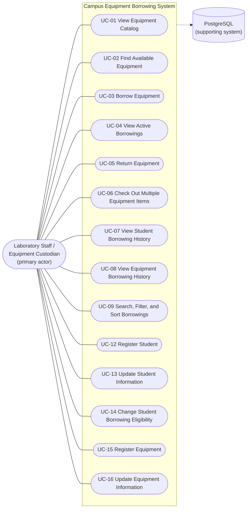

# Use-Case Diagram — Laboratory Activity 4

The custodian is the primary actor. PostgreSQL is the supporting system. No include or extend relationships are drawn. Deferred cases (UC-10, UC-11, UC-17 to UC-27) and future cases (UC-28 to UC-33) are outside the system boundary.

GitHub renders the diagram above. To get a PNG for the submission, paste the Mermaid block into https://mermaid.live and export the image to `docs/use-case-diagram.png`.
